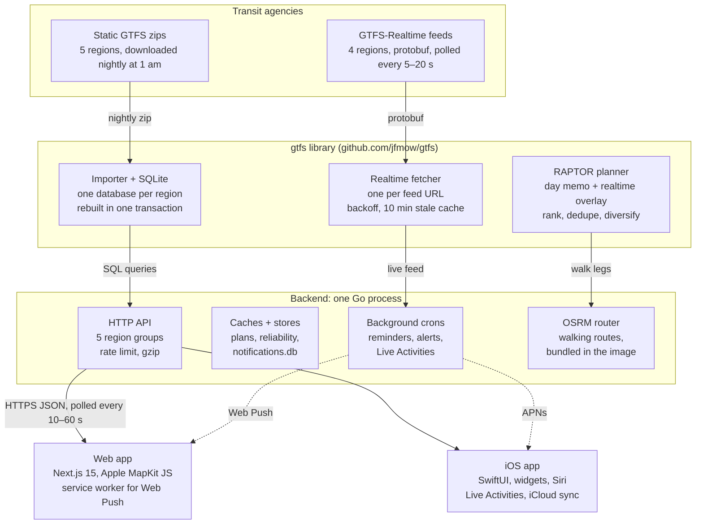
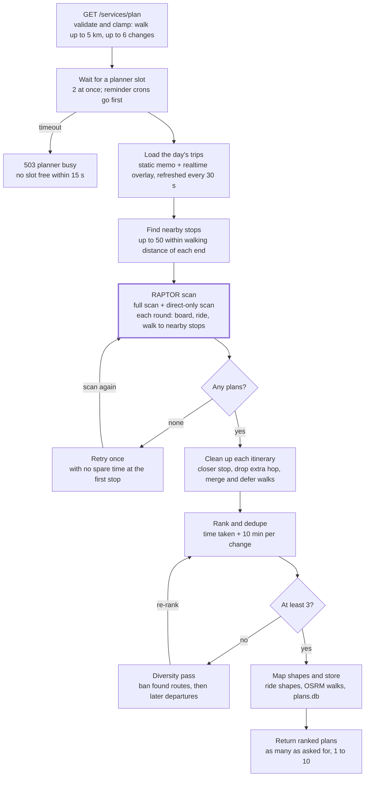
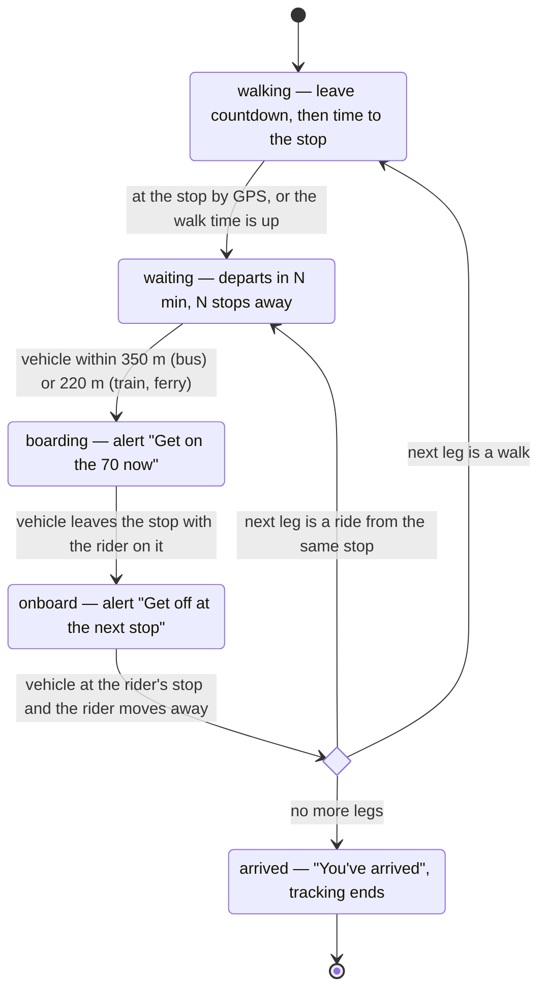
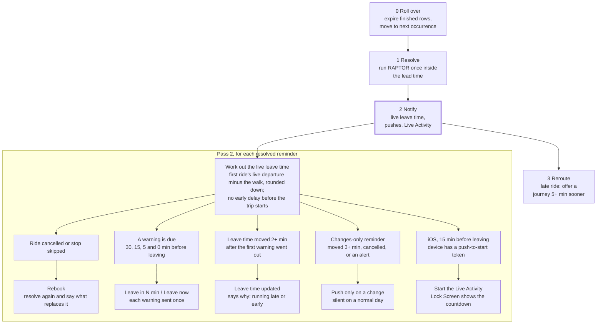
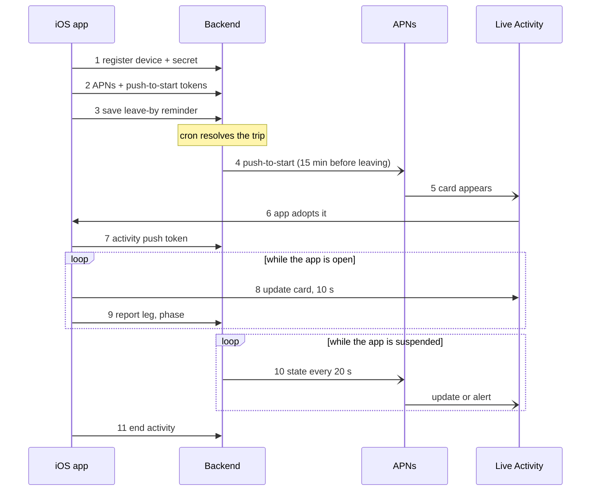

# GTFS New Zealand — System Architecture

As of 2026-11-03. Live, editable copy: https://claude.ai/artifact/TsEPsMfi3ab98PG6hqEB8a

## Overview

The app is a live public-transport companion for five regions: one Go server turns each region's GTFS timetable and GTFS-Realtime feeds into departure boards, live vehicle maps, journey plans and push alerts, served to a Next.js web app and a native SwiftUI iPhone/iPad app. It has three layers:

1. **`github.com/jfmow/gtfs`** (v1.3.34): a Go library the backend imports. It downloads each static GTFS zip into its own SQLite database, polls the realtime feeds, and contains the RAPTOR journey planner.
2. **Backend** (`backend/`, Go module `github.com/jfmow/at-trains-api`): an Echo v5 HTTP server. It mounts one route group per region and owns caches, fares, reliability history, plan storage and every push notification (Web Push, APNs and Live Activities).
3. **Clients**: the web app (`frontend/`, Next.js 15 + React 18 + Tailwind + Apple MapKit JS) and the iOS app (`ios/`, SwiftUI, about 150 Swift files including widgets and Live Activities).

| Region | Path | Static feed | Realtime | Poll interval | Time zone |
| --- | --- | --- | --- | --- | --- |
| Auckland (AT) | `/at` | gtfs.at.govt.nz | One combined `/realtime/legacy` feed | 17.78 s | Pacific/Auckland |
| Wellington (Metlink) | `/wel` | opendata.metlink.org.nz | 3 separate feeds | 5 s | Pacific/Auckland |
| Christchurch (Metro) | `/christ` | apis.metroinfo.co.nz | 3 separate feeds | 20 s | Pacific/Auckland |
| South East Queensland | `/seq` | TransLink SEQ | 3 separate feeds, no key | 15 s | Australia/Brisbane |
| Otago (Orbus) | `/otago` | orc.govt.nz | None, timetable only | n/a | Pacific/Auckland |

Auckland's poll interval comes from its API quota: 35,000 requests a week. One combined request every 17.78 s is at most 34,016 a week, which leaves about 1,000 for retries.

The diagram below shows how the parts fit together.

The agencies are only ever called by the backend. Both apps pull from the HTTP API, and the crons push through APNs and Web Push. Solid lines: data pulled on request. Dashed: the server pushes alerts, reminders and Live Activity updates.

## The gtfs library

`github.com/jfmow/gtfs` turns each region's timetable zip into a local SQLite database, rebuilt in one transaction every night at 1 am. It also holds the realtime client and the journey planner. Its source sits in the Go module cache (`~/go/pkg/mod/github.com/jfmow/gtfs@v1.3.34`); the main files are `journey.go` (2,900 lines), `stops.go`, `services.go`, `database.go` and `realtime/`.

### Static feed lifecycle

At startup `gtfs.New` decides whether to reuse the database on disk:

- **Reuse** when `feed_info.feed_end_date` is still in the future, or when `feed_info` is unreadable but the core tables (`stops`, `routes`, `trips`, `stop_times`) hold data. It then makes sure indexes exist and tidies headsigns.
- **Rebuild** otherwise, with up to 3 attempts 30 s apart.

A rebuild (`refreshDatabaseData`) runs as one SQLite transaction, so readers never see a half-loaded feed:

1. Download the zip, sending an API key header where the feed needs one (Christchurch).
2. Drop the old tables and create the default GTFS tables.
3. Stream every CSV through a bulk inserter. Rows are grouped by the columns they fill, then written as multi-row INSERTs, and a UTF-8 BOM in a header is stripped.
4. Tidy headsigns, then build n-gram tables for stop and route search.
5. Build about 45 indexes after the load, so the roughly 1 million `stop_times` rows don't pay index upkeep on every insert.
6. Commit, then run `wal_checkpoint(TRUNCATE)`, `PRAGMA optimize` and `VACUUM`, and give freed memory back to the OS.
7. Drop the planner's trip-times memo and broadcast on `refreshNotifier`.

A cron job repeats this at 1 am in the region's time zone, with 3 attempts 5 min apart, under a shared mutex so only one region rebuilds at a time.

### Caches

`GenerateACache` wraps any query in a read-locked in-memory value that reloads itself whenever `refreshNotifier` fires. The backend builds its route, stop, parent-stop and trip-stops caches with it (`providers/caches`), so every cache follows the nightly rebuild with no restart.

### Realtime client (`realtime/`)

- **One fetcher per feed URL.** All callers share it, so the poll interval caps requests to that URL however many users are online. Auckland's combined feed uses one fetcher for vehicles, trip updates and alerts.
- **Failure handling.** After a failed fetch, the wait doubles up to 5 min (never shorter than the upstream `Retry-After`). The last good data is served for up to 10 min. A 403 from Auckland means the weekly quota is used up.
- **Disabled client.** Otago has no feeds; every getter returns `ErrNoRealtime` and the app shows the timetable only.
- **Train consists** (`consist.go`). Auckland's feed doesn't say whether a train has 3 or 6 cars. Only the lead unit carries the trip, so the library pairs each unit that has a trip with a same-class unit travelling alongside it that has none.
- **Trip history** samples vehicle positions and updates per trip. It is off by default.

### Time rules the library enforces

| Rule | Why |
| --- | --- |
| Service day starts at noon minus 12 h, not midnight | GTFS times count from that point; on a daylight-saving day midnight is an hour off (fixed in v1.3.23) |
| Delays outside −10 min … +2 h are clamped to the edge | A large "early" value is almost always a stale feed entry |
| Stop times are clamped forward to stay in order | Realtime can push a stop's arrival before the previous departure, which made legs that arrive before they leave |
| No early predictions before a trip's start time, and up to 10 min after it while no vehicle is on it | AT publishes predictions for trips that haven't left yet, carried over from the previous trip |
| Updates with no start date apply to today only | Stops them leaking onto reused trip IDs on future days |
| Departure boards and boarding use `pickup_type`; alighting uses `drop_off_type` | Wellington origins are drop-off-only, termini are set-down-only (v1.3.21) |

## Backend

The backend is one Go process (Echo v5, port 8090) that builds all five regions in parallel at startup and then serves them from the same route set under `/at`, `/wel`, `/christ`, `/seq` and `/otago`. Its persistent state is three kinds of SQLite file in `DATA_DIR`: one GTFS database per region, a shared `notifications.db`, and `reliability.db` + `plans.db`.

### Startup (`main.go`)

1. Load `.env` (`AT_APIKEY`, `WEL_APIKEY`, `CHRISTCHURCH_APIKEY`, APNs and VAPID keys). Set `GOGC=60` so planner allocations don't push the heap over the container's memory limit.
2. For each region, at most 2 at a time: `gtfs.New` (reuse or rebuild the database), create the realtime client (combined, separate or disabled), warm the caches, and start the planner warm-up.
3. Register each region's routes in turn through `providers.SetupProvider`, which also starts that region's crons.

Every request passes through the same middleware: a trace ID, a JSON request logger (lumberjack, 100 MB files, 7 days), CORS for GET/POST, a 64 KB body limit, and a per-IP rate limit of 10 requests/s with a burst of 30. The client IP comes from `X-Forwarded-For` only when the request arrives from a trusted proxy (private ranges or `TRUSTED_PROXIES`). Every handler answers `{code, message, data, trace_id}`.

### API surface (per region)

| Group | Endpoints | What it serves |
| --- | --- | --- |
| `/services` | `/:station`, `/:station/schedule`, `/plan`, `/plan/:id` | Departure boards, a stop's timetable, journey plans and stored plans |
| `/realtime` | `/live`, `/alerts/:stop`, `/alerts/route/:id`, `/stop-times`, `/journey`, `/find-my-vehicle/:lat/:lon` | Vehicle positions, alerts, live stop times for a trip, a live journey refresh, "which vehicle am I on" |
| `/stops` | `/stops`, `/:tripId`, `/closest-stop`, `/stop/:id`, `/find-stop/:name` | Stop lists, a trip's stops, nearest stop, search |
| `/routes` | `/routes`, `/:routeId`, `/find-route/:name` | Route list and search |
| `/map` | `/geojson/shapes`, `/nav`, `/search`, `/reverse` | Route shapes, walking directions, place search and reverse geocoding |
| `/reliability` | `/connections`, `/route`, `/league` | How often a change works, a route's day and trend, the weekly league table |
| `/fares` | `/fares`, `/fares/types` | Fare estimate for a plan, concession types |
| `/notifications`, `/devices` | `add`, `edit`, `remove`, `reminder`, `route/*`, `journey-reminder(s)`, `history/*`, `mine`, `test`; `register`, `update-token`, `unregister` | Alert subscriptions, stop reminders, leave-by reminders, device registration |
| `/live-activities` | create, `update-token`, `leg`, `end` | iOS Live Activity registration and progress reports |

### Support packages (`backend/providers/`)

- **`caches`**: route, stop, parent-stop and trip-stops maps, refreshed by the gtfs library's notifier.
- **`planlimit`**: allows 2 planner runs at once, because each run allocates about 100–200 MB. Background work (reminder resolve, reroute, next journey) jumps the queue ahead of user plan requests.
- **`plan_store.go`**: every plan is saved to `plans.db` under its UUID for 6 h past arrival, capped at 20,000 rows. Shared links, reminders and Live Activities all load plans from here.
- **`vehiclestate`**: one shared answer to "what is this vehicle doing" (`Arriving`, `AtStop`, `Leaving`, `Travelling`), used by both the map and the notification crons.
- **`timetable`**: read-only timetable questions the library doesn't answer, such as trips per hour and the longest trip on a route.
- **`reliability`**: a recorder samples trip updates every 30 s into `reliability.db`, and logs alerts every 5 min. It drives route trends (28 days, 52 weeks), the league table (7 days, at least 50 samples) and connection odds such as "Works 9 times in 10".
- **`fares`**: hand-maintained adult smartcard fares and transfer rules for Auckland, Wellington, Christchurch and Otago, because none of the feeds carry usable fare data. A fare marked `Partial` ("$4.90+") means some rides couldn't be priced.

### Background jobs (per region)

| Every | Job | Hours |
| --- | --- | --- |
| 14 s | Stop reminders: "your stop is coming up" for a tracked trip | 4 am to midnight |
| 20 s | Live Activity progress pushes (fallback when the app is suspended) | Always |
| 30 s | Trip-update scan: cancellations for subscribed stops and routes | 4 am to midnight |
| 30 s | Service-alert scan for subscribers | 4 am to midnight |
| 30 s | Leave-by reminders: resolve, notify, reroute | 3 am to midnight |
| 30 s | Reliability recorder | Always |
| 1 h | Web Push expiry warnings, stale reminder pruning, nightly `notifications.db` maintenance at 2 am (primary region only) | Always |
| Daily, 1 am | GTFS rebuild (gtfs library) | n/a |

Each job takes a `TryLock` mutex, so a slow tick is skipped rather than stacked. The cron chain recovers from panics, so one failed job can't take down the process.

### Push delivery

A notification is built once as a channel-neutral `Payload`, then handed to the sender for the client's platform:

- **Web Push** (VAPID, `webpush-go`): no redirects are followed, and only allow-listed push-service hosts are reached. Web subscriptions expire after 30 days, with a warning on day 29.
- **APNs** (`apns2`, `.p8` key from `APNS_KEY_ID`, `APNS_TEAM_ID`, `APNS_BUNDLE_ID`, `APNS_KEY_P8`): alerts, Live Activity updates, and push-to-start for Live Activities. iOS devices register with an ID and a Keychain secret (stored hashed), and send them as `X-Device-Id` / `X-Device-Secret` headers.

A client that the channel reports as gone (Web Push 410, APNs `Unregistered`) is cleaned up by the sender. If one channel isn't configured, the other keeps working.

## Journey planning

A plan request becomes up to 10 ranked itineraries by running RAPTOR (a round-based public-transit search) over the day's timetable with realtime applied, then rescanning with routes banned to find genuinely different options. The work sits in `PlanJourneysRaptor` in the gtfs library's `journey.go`; the backend's `GET /services/plan` validates input, takes a planner slot and stores the results.

The heavy work is the RAPTOR step, which runs once with changes allowed and once direct-only. Both loops on the right only fire when the first pass comes up short.

### Request inputs

| Parameter | Default | Bounds / notes |
| --- | --- | --- |
| `startLat/Lon`, `endLat/Lon` | required | Coordinates, not stops: the planner picks nearby stops itself |
| `date` + `timeType` | now, `departat` | `arriveat` switches to a backward scan; the date must fall inside the planning window |
| `maxWalkKm` | 1.0 km | Clamped to 5 km |
| `walkSpeed` | 3.6 km/h | Slow / Normal / Brisk = 2.5 / 3.6 / 4.5; older scales (3 / 4.8 / 5.5, 2.8 / 4.0 / 5.0) are mapped forward |
| `maxTransfers` | 2 | Clamped to 6 |
| `minResults` | 3 | 1–10, also used as the maximum |
| `modes`, `onlyRoutes` | any | Restrict rides to route types (bus, train, ferry) or named routes |
| `minTransferSec` | 0 | Extra time added to every change |

The planner considers up to 50 stops near each end, and includes child stops (platforms).

### How a scan works

1. **Day setup.** Work out the service-day start (noon minus 12 h) and load every trip's stop times for that day. A static copy is built once per day and memoised; the realtime overlay is reapplied at most every 30 s. A background warm-up keeps it built so no request pays the roughly 2 s build.
2. **Origin walk.** Each nearby start stop is reached at `depart + walk time`. Round 0 needs 2 min spare at the first stop; this drops to 0 only if nothing else works (for example the last service of the night).
3. **Rounds.** Each round scans every trip. A trip is boarded at the first stop the previous round improved, if the stop allows pickup and the trip is usable (not cancelled or skipped). Every later stop that allows drop-off and is reached sooner gets a new arrival time and a pointer back to where it was boarded. A change needs at least 60 s plus `minTransferSec`.
4. **Foot transfers.** After each round, arrivals spread on foot to stops 50–400 m away (up to 8 per stop, walking at 4.6 km/h plus a 30 s buffer), and to other platforms of the same station (120 s). This graph is cached for 30 min.
5. **Destinations.** The best end stops are picked by arrival time plus the walk to the destination. Legs are rebuilt by following the back-pointers.

### Cleaning up each itinerary

- **Closer boarding stop**: board the same trip at a stop nearer the origin if one exists.
- **Drop a redundant first hop**: remove a short first ride when the second ride also called near the start in time to catch it.
- **Merge walk legs** that sit next to each other, and **defer the origin walk** so the rider leaves just in time rather than now.
- **Recount transfers** from the final legs and drop anything over the limit.

### Ranking and variety

Each itinerary costs the time it takes out of the rider's day plus a **10-minute penalty per change**. For depart-after, that time is arrival minus the requested departure; for arrive-by it's the target minus the leave time. Ties go to fewer changes, then less walking, then earlier arrival.

RAPTOR keeps only the earliest arrival per stop, so a direct bus a few minutes slower than a two-bus option would never surface. The planner therefore also runs a **direct-only scan** and lets the penalty decide. Duplicates with the same sequence of rides are collapsed. If fewer than the target number remain (at least 3), the **diversity pass** reruns the scan with the routes already found banned (phase A), then asks for later departures on the same corridor (phase B).

Finally, the map GeoJSON is built only for the chosen results: rides use their shape cut between the boarding and alighting stops, and walks use OSRM routing (cached for 24 h, up to 2,000 entries), falling back to a straight line. Each plan gets a UUID, is cached in memory until 30 min after arrival, and is written to `plans.db` so links, reminders and Live Activities can reopen it.

### Realtime inside the planner

The overlay uses trip delays, per-stop delays, skipped stops and cancellations, applying the time rules listed in the gtfs library section. A cancelled trip or skipped stop is marked unusable, so RAPTOR routes around it. Each leg carries its scheduled and live times, a status (`on_time`, `delayed`, …) and `vehicle_tracked`, which is true only when a vehicle is actually reporting on that trip.

## Calculations and decisions

Most of the app's judgement calls come down to one question: how far to trust the live feed versus the timetable and the rider's own GPS. The rule throughout is that the timetable is the floor, realtime refines it within bounds, and anything that would move the rider backwards (an earlier leg, fewer stops travelled) has to persist before it is believed.

### Departure boards

`GET /services/:station` lists trips calling at a station's child stops, using `GetActiveTrips`. A trip is shown only if passengers can board there (`pickup_type`), so termini and drop-off-only origins drop out. Each row maps the child stop to its parent station and a platform. If the trip-stops cache is missing a trip (common just before a feed rollover), the departure is kept rather than silently dropped. The client then overlays realtime from `/realtime/stop-times` and `/realtime/live`.

### What a vehicle is doing (`vehiclestate`)

1. If the vehicle reports its own status (`STOPPED_AT`, `INCOMING_AT`, `IN_TRANSIT_TO`), use it: it is the most reliable signal.
2. Otherwise scan the trip updates for the first upcoming event. A predicted "at stop" is trusted only when the vehicle's GPS is within 100 m of that stop, because predicted times can pass before a delayed vehicle gets there.
3. With no future event, assume the stop after the last one departed.

The iOS app adds a ratchet on top: a lower "next stop" is believed only after it has lasted a hold period, so "2 stops away" doesn't flick back to 3 while AT's feed alternates around a stop.

### Which leg the rider is on

`JourneyProgressModel` (iOS, ported from the web's `route-detail-sheet.tsx`) is the subtlest piece of logic in the clients:

- **Clock-based guess.** The first leg whose live-adjusted arrival is still ahead.
- **Transit floor.** The guess can't pass the earliest ride the rider might still be on. Advancing past it needs real evidence: GPS showing they got off, or a generous timeout after the ride's arrival. This fixed a 2026-09-16 bug where the walk after a train showed while the rider was still aboard.
- **Alighted ratchet.** Once the rider is known to have got off a ride, tracking never moves back before it. The ratchet is saved, so it survives a relaunch.
- **At the stop (hysteresis).** "Waiting at the stop" starts within an enter distance and ends only past a larger exit distance, so GPS jitter doesn't flip it.
- **Board now.** The vehicle is within 350 m of the boarding stop for buses (the rider may need to flag it down) or 220 m for trains and ferries.
- **Got off.** The vehicle is at the rider's stop and the rider is a short distance from it. This fires before the feed reports the vehicle leaving, which lagged by minutes.

Offline, `OfflineRideEstimator` turns the rider's GPS into a synthetic vehicle placed on the trip's stops, so the same model works without data. Boarding needs two agreeing fixes in a row, moving faster than walking along the route line.

### Live Activity phases

The server builds the same card content as the app (`computeJourneyActivityState`), so a hand-off between the two never changes the wording. Each leg's times shift by realtime: rides by their own trip's delay, walks with the ride they connect to. The phone's last report (leg, phase, when the rider left) is a floor the server never moves behind.

Without a live vehicle position, waiting becomes boarding on the clock as departure nears. A cancelled ride or skipped stop puts a warning on the card in any phase, and the alert carries the next way to go.

### Leave-by reminders

The leave time is the first ride's live departure minus the walk to its stop, rounded down to the minute. The default warnings are 30, 15, 5 and 0 min before it.

- **Early predictions are ignored before the trip starts.** For leave-time maths, delay is clamped to 0 … +2 h, because an early prediction for a trip that hasn't started is the previous trip's running carried over. A ride already under way that is early is taken from the Live Activity lookup instead.
- **Re-notify on a shift.** Once the warnings have started, a move of 2 min or more sends "leave time updated". "Changes only" reminders stay silent unless the leave time moves 3 min or more, the ride is cancelled, or an alert touches the journey.
- **Reroute.** Within 90 min of leaving, a ride running 10 min late (or an arrive-by journey predicted 1 min late) is re-planned with realtime. A new journey must arrive at least 5 min sooner and leave at least 2 min from now. Each reminder is checked at most every 5 min, and 2 per tick.
- **Next way to go.** If an early ride means the rider will miss it, the "you'll miss it" alert carries a re-planned journey from where they are. When the leave time moves 2 min or more earlier than planned, the app also looks for a journey that leaves at the original time and arrives within 15 min of the plan.
- **Live Activity start.** On iOS, the journey's Live Activity is push-started 15 min before the leave time.

The five checks in the Notify pass are not exclusive; each tick tests all of them against the latest leave time. Resolve and Reroute both need a planner slot, and take it ahead of user requests.

### Fares

Fares are estimated, not read from the feeds: their fare tables are empty. Each region's calculator (`fares/auckland.go`, `wellington.go`, `christchurch.go`, `otago.go`) groups rides joined by free transfers into one fare, using a transfer window, a maximum number of rides and a maximum span. It prices them by zones or flat fare for the chosen concession, and returns a label such as "$4.90" or "$4.90+" when part of the journey (for example a ferry) can't be priced. SEQ has no calculator. Prices change most years, usually on 1 July, and are updated by hand.

## Communication

Clients pull data over plain HTTPS JSON (`https://trainapi.suddsy.dev/<region>/…`) on fixed timers while a screen is visible. The server pushes only for alerts, reminders and Live Activities, through Web Push or APNs. No sockets are involved. Upstream, the backend is the only thing that talks to the transit agencies, so the number of users never changes the request rate to them.

### Pull: client polling

| Screen | Web | iOS | Endpoint |
| --- | --- | --- | --- |
| Departure board | 10 s | 10 s | `/services/:station` + realtime |
| Live map vehicles | 10 s | 10 s (vehicle quick look) | `/realtime/live` |
| Service tracker | 10 s | 10 s | `/realtime/live`, `/realtime/stop-times` |
| Journey vehicles / stop times | 10 s / 20 s | 30 s on the journey screen | `/realtime/journey`, `/realtime/stop-times` |
| Home stop rows | 30 s | 30 s | `/services/:station` |
| Notification bell / feed | 60 s | 60 s | `/notifications/mine` |
| Upcoming reminders | n/a | 60 s | `/notifications/journey-reminders` |

On the web, Home stop rows skip a poll while the tab is hidden; iOS polls only in the foreground and halves the rate in Low Power Mode. Since the backend caches the feeds, a 10 s client poll against Auckland's 17.78 s upstream refresh often returns the same snapshot as the last poll.

### Push: subscribing and delivery

- **Web**: the service worker `/pwa/sw.js` subscribes with the VAPID public key (`NEXT_PUBLIC_VAPID_PUB`). The endpoint, `p256dh` and `auth` are posted with every notification request, and identify the client.
- **iOS**: at every launch the app registers its device ID and Keychain secret (`/devices/register`), then sends this launch's APNs token and its ActivityKit push-to-start token (`/devices/update-token`). The APNs environment is read from the provisioning profile, because a wrong environment makes every push fail with `BadDeviceToken`.
- **Live Activities**: each activity registers its own push token (`POST /live-activities`). While the app is open it reports its leg, phase, headphones and set-off time (`/live-activities/leg`) and updates the card itself every 10 s. When the app is suspended, the server's 20 s cron pushes updates instead, with a heartbeat every 4 min. Key moments expand the Dynamic Island rather than showing a banner, except setting-off alerts, which send both. With AirPods in, moments go out as Time Sensitive notifications so Siri reads them aloud.

Async arrows are server pushes through APNs; solid arrows are app requests or on-device updates. The phone's reports in step 9 are the floor the server's own state never moves behind.

### Links, sync and sharing

- **Universal links**: `/.well-known/apple-app-site-association` on the web host hands `/trip?tripId=`, `/journey?id=`, `/map?tripId=` and the old `/vehicles?tripId=` to the iOS app. A shared `/journey?id=` reopens the exact stored plan through `/services/plan/:id`.
- **iCloud**: saved stops, places and trips live in SwiftData with CloudKit mirroring. The store sits in the app group container, and its schema only ever adds fields. None of this touches the backend.
- **Widgets, Siri and quick actions** read the region, saved stops and places from the app group (`SharedStore`), and fetch departure boards from the API themselves.

## Web frontend

The web app (`frontend/`, package `at-tracker`) is a Next.js 15 Pages Router app (served by `next start`, which also handles its redirects and the universal-links header), not a static export; the old `out/` folder is a leftover build. It is installable as a PWA. Its UI follows the iOS app (the parity work merged 2026-09-29) on a neutral Geist look built from Tailwind and shadcn/Radix components.

| Page | What it does |
| --- | --- |
| `/` (Home) | Saved stops with live departures, saved trips, nearby stops, first-visit card |
| `/map` | One map with two modes, `?mode=stops` and `?mode=vehicles` (`/stops` and `/vehicles` redirect here); tracks a vehicle with `?tripId=` |
| `/plan` | Journey planner: search form, options (walk speed, transfers, modes, routes), results, "easy" step-by-step view, leave reminder dialog |
| `/journey` | A planned journey opened by `?id=`, with live tracking (`route-detail-sheet.tsx`) |
| `/trip` | Service tracker for one trip: a full map with a bottom drawer on mobile, split map + detail on desktop |
| `/alerts` | Service alerts for the region |
| `/reliability` | Route trends, hours of the day and the weekly league table |
| `/settings` | Region, walk speed, fare type, notifications, theme |

### Key pieces

- **Region selection** (`lib/url-store.ts`, `lib/url-context.tsx`): the five regions, each with its API base URL, map centre, country, time zone and a `realtime: false` flag for Otago. The table itself lives in `packages/shared/src/regions.ts` (shared with the Expo app in `mobile/`); `url-store.ts` keeps the selected region. These must stay in sync with `backend/main.go` and iOS `Region.swift`.
- **Shared package** (`packages/shared`, `@transit/shared`): platform-free TypeScript used by the web and the Expo app: the API client (`ApiFetch` wraps `createApiClient`), regions, region-time maths, formatting, the easy-planner steps and the API types. It's linked with `file:` and compiled by Next (`transpilePackages`); `frontend/lib/*` files re-export it with the selected region filled in. See `plans/expo-app.md`.
- **Map** (`components/map/`): Apple MapKit JS v6 with the token in `NEXT_PUBLIC_MAPKIT_TOKEN`. It uses the app's own camera maths, `supercluster` for stop clusters, and Lucide icons for markers, whose icons and colours match the stop list. MapKit JS has no 3D, so the 3D map is iOS-only.
- **Journey tracking** (`components/journey/`): `route-detail-sheet.tsx` holds the original leg-advance state machine that iOS ported. `use-journey-vehicles.ts` (10 s) and `use-journey-stop-times.ts` (20 s) feed it. `journey-alert-overlay.tsx` shows the in-app "get on now" and "get off next" moments.
- **Departure board and tracker** (`components/services/`): the live board polls every 10 s; the tracker shows occupancy and accessibility details and lets the rider set a stop reminder.
- **Notifications** (`lib/notifications.ts`, `components/notifications/`): service worker registration, the Web Push subscription, stop and route alert subscriptions with cause and severity filters, and the bell feed.
- **Plain-English steps** (`lib/easy-planner.ts`): turns a plan into steps a first-time rider can follow. A bus is named by its number; a train or ferry line code is only a detail.

## iOS app

The iOS app (`ios/`, bundle `dev.suddsy.transit`, iOS 17.2+) is a native SwiftUI app for iPhone and iPad. It talks to the same backend as the web, and adds what only the device can do: Live Activities, GPS-driven and offline journey tracking, widgets, Siri and iCloud sync. It merged to master on 2026-09-25 (PR #21), with iPad support following on 2026-09-28 (PR #23).

### Targets and modules

| Part | Contents |
| --- | --- |
| `Transit/` (app) | `App/` (entry, environment, Siri intents, quick actions), `DesignSystem/` (shell, bottom drawer, side panel, theme), `Map/` (MapKit map, annotations, camera), `Services/`, `Views/` |
| `Packages/TransitCore` | Platform-free logic, testable on its own: `API/` (client, endpoints, regions, deep links), `Models/`, `Logic/` (journey progress, offline estimator, reminders, Live Activity content, ranking, easy planner), `Store/` (SwiftData models, device identity, offline packs) |
| `TransitWidgets` | `DeparturesWidget` and the `JourneyLiveActivity` (Lock Screen + Dynamic Island) |
| `Shared/` | Code used by both the app and the extension: `JourneyActivityAttributes` (the Live Activity contract mirrored by the server), `SharedStore` (app group), route colours, saved-stop intents |

### Screens

There are four tabs: **Home** (compact shortcuts and grouped stop rows), **Planner**, **Map** (stops and vehicles in one map) and **Alerts** (hidden for Otago, which has no realtime). First launch runs an onboarding flow. The Planner offers the full planner and an "easy" planner that asks four questions in turn, using the backend's `modes` and `minTransferSec` filters. On iPad, layouts follow the size class, with a map side panel in place of the bottom drawer.

### Services

- **`JourneyTrackingSession`**: runs a tracked journey and feeds `JourneyProgressModel` and `JourneyAlertCenter` (in-app "get on now" and "get off next").
- **`LiveActivityCoordinator`**: starts, updates and ends the Live Activity, registers its push token, and adopts activities that a reminder push-started while the app was closed.
- **`PushRegistrationService`**: device registration and APNs plus push-to-start tokens, sent on every launch.
- **`LocationProvider` + `JourneyGPSPolicy`**: picks the cheapest GPS accuracy that still works in the background (below).
- **`JourneyOfflineNotifications`**: schedules local notifications for the journey's key moments, so alerts still fire with no data.
- **`DeepLinkRouter`**: universal links and notification taps to the right tab and screen. **`CloudSyncMonitor`**: iCloud account state and post-import tidy-up.

### Battery-aware GPS

| Level | When |
| --- | --- |
| `resting` (coarse cell/Wi-Fi) | On board, the live feed is tracking the vehicle well, there's a connection, and the rider's stop is still a way off |
| `coarse` | Still at the start, well before the leave time: enough to see them set off (150 m move, fix good to 100 m) |
| `pedestrian` | Walking or waiting: GPS, but only after moving a few metres |
| `precise` | On board with no live feed, or nearing the stop: get-off alerts and the next walk run from GPS |

On screen, GPS is always precise because the map follows the rider. The tracker must read `preciseCoordinate` so a coarse fix never places the rider.

### Offline journeys

While a connection exists, the app saves an `OfflineJourneyPack` (one JSON file in Application Support): the plan, each ride's stops with coordinates, the latest predictions, route shapes and walking directions. It is refreshed on every successful poll. With no data, `OfflineRideEstimator` places the rider on the trip from GPS, and local notifications replace server pushes. Before boarding, the vehicle's position can't be known offline, so that part falls back to the timetable plus the last delay seen.

### Map

`TransitMapView` uses MapKit for SwiftUI with its own camera engine: follow a vehicle, follow the rider with compass heading, or frame a set of points inside the area overlays leave free. It supports 3D, a chase camera, and vehicles that glide between position updates (a setting).

## Operations and reference

The backend ships as one Docker image that also carries its own OSRM walking router. It is pushed to `registry.tail4520a7.ts.net/trains:latest` and served to the internet through a Cloudflare Tunnel at `trainapi.suddsy.dev`.

### Build and run

- **Build**: `docker buildx build --platform linux/amd64 -t registry.tail4520a7.ts.net/trains:latest --push .` from `backend/` (`build-cmd.txt`). The builder is Go on Debian bookworm with CGO on; the runtime is the official OSRM image, which supplies `osrm-extract` / `-routed` and the foot profile.
- **Walking router**: `docker-entrypoint.sh` builds a foot graph from `OSRM_PBF_URL` (one or more `.osm.pbf` extracts, optionally cropped and merged), caches it in `/data/osrm`, and runs it on loopback port 5000. If the build fails, usually from lack of memory, the API starts anyway and uses `OSRM_URL`.
- **Volume**: everything is written under `/data`: `gtfs/`, `notifications/`, `plans/`, `logs/`, `osrm/`.
- **Local stack**: `docker compose up --build` on port 8085 with BBBike's Auckland extract (about 70 MB). `npm run go` in `frontend/` runs `go run .` and `next dev` together.
- **Order of deploys**: when a client depends on a new backend parameter (for example the easy planner's `modes`), the backend goes out first.
- **Memory**: `GOGC=60` (override with `GOGC_PERCENT`), 2 planner slots, and regions built 2 at a time keep a cold start within the host's limit.
- **API testing**: the `Yaak/` folder holds a request collection matching the current routes.

### Data-source quirks to remember

| Source | Quirk | Handling |
| --- | --- | --- |
| Auckland Transport | 35,000 realtime requests a week; 403 when used up | One combined feed every 17.78 s, backoff, 10 min stale serving |
| Auckland Transport | Publishes predictions for trips that haven't started and omits origin-stop predictions | Realtime sequence logic only after the trip starts |
| Auckland Transport | No consist data; the trailing train unit has no trip | Consists inferred by pairing units (`consist.go`) |
| Auckland Transport | GPS jitter around stops (`STOPPED_AT` and `INCOMING_AT` alternate) | 100 m proximity check + progress ratchet |
| Auckland Transport | Trip-stops cache can miss trips near a feed version rollover | Departure kept without sequence normalisation (fixed v1.3.14) |
| Metlink | Origins are `drop_off_type=1`; code-like headsigns | Board on pickup only (v1.3.21); headsigns tidied (v1.3.22) |
| Christchurch | `feed_info.txt` has a UTF-8 BOM | BOM stripped from CSV headers |
| Otago | No GTFS-RT | Disabled realtime client; Alerts tab hidden |
| SEQ | Brisbane time zone, no API key | Region time zone; no fares calculator |
| All feeds | Empty fare tables | Hand-maintained fares, updated each July |
| All feeds | Daylight-saving days | Service day starts at noon minus 12 h (v1.3.23) |

### Where to look

| Question | File |
| --- | --- |
| Regions, keys, poll rates | `backend/main.go`, `packages/shared/src/regions.ts`, `TransitCore/API/Region.swift` |
| Route registration | `backend/providers/setup.go` |
| Departure boards and plans | `backend/providers/services.go` |
| Live vehicles, stop times, alerts | `backend/providers/realtime.go` |
| Planner algorithm | `gtfs/journey.go` (module cache) |
| Feed import and refresh | `gtfs/main.go`, `gtfs/database.go`, `gtfs/create.go` |
| Realtime fetch and consists | `gtfs/realtime/feed.go`, `consist.go` |
| Crons and notification routes | `backend/providers/notifications/routes.go` |
| Leave-by reminders | `notifications/journey_reminders*.go`, `next_journey.go` |
| Live Activity content | `notifications/live_activity_state.go`, `TransitCore/Logic/LiveActivityContentBuilder.swift` |
| Which leg the rider is on | `TransitCore/Logic/JourneyProgressModel.swift`, `frontend/components/journey/route-detail-sheet.tsx` |
| Fares | `backend/providers/fares/` |
| Plans and design notes | `plans/`, `backend/plans/` |
